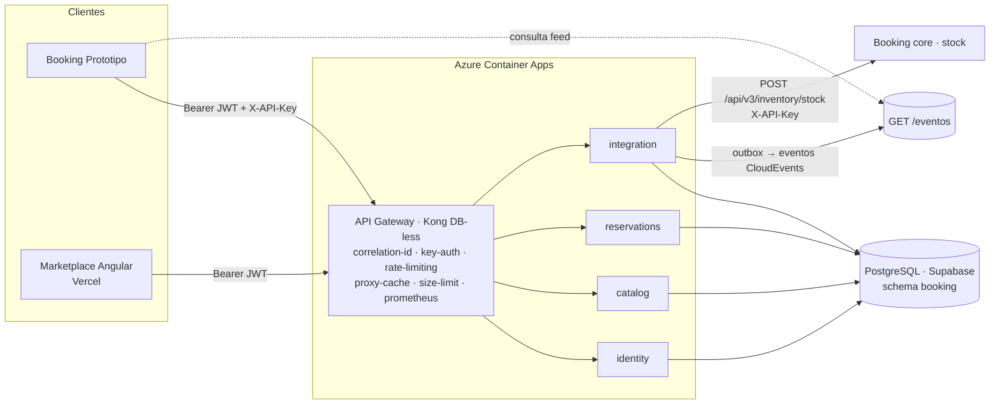

# Posada EC — Arquitectura de microservicios (Reto 2)

Nodo `NODE_ALO_PEC` · vertical ALOJAMIENTOS · contrato Booking v2.2.0 · Integración de Sistemas, PUCE.
Cubre los entregables 1, 5, 6, 7, 8 y 9 del Reto 2 (semanas 7 a 11).

## 1. Qué cambió respecto al Reto 1

| Reto 1 (semanas 1–6) | Reto 2 (semanas 7–11) |
|---|---|
| Un solo backend NestJS, una URL pública | **4 microservicios** detrás de un **API Gateway (Kong)** |
| Sin integración | Booking consume el nodo por el gateway (36 operaciones del contrato v2.2.0) y Posada le envía el stock |
| Logs simples | Logs JSON + `X-Correlation-Id` de extremo a extremo + métricas Prometheus |
| JWT y scopes | JWT, scopes, API key por consumidor, rate limit por consumidor y auditoría de operaciones críticas |

## 2. Diagrama de integración

Flujo de una reserva: `Booking → Kong → reservations` (`POST /orders/create`, idempotente, ≤ 3 s) → la transacción escribe la reserva y un evento en el **outbox** → `integration` publica el evento y empuja el stock de las noches afectadas a Booking.

## 3. Decisión de arquitectura (para la defensa)

**Decisión.** *Monolito modular desplegado como 4 servicios.* El código se mantiene en un solo repositorio y una sola imagen Docker; cada despliegue arranca con `SERVICE_ROLE` distinto y solo atiende las rutas de su servicio (cualquier otra ruta responde 404 `application/problem+json`). El gateway enruta por esas mismas reglas.

**Por qué así y no reescribir en 4 repositorios** (criterio de la semana 13 «cuándo y cómo»):
- El contrato v2.2.0 ya está en producción y registrado en Booking: cambiar la lógica de negocio ahora arriesga la integración que ya funciona.
- Es el patrón *Strangler*: primero se separa el **despliegue y el enrutamiento**, después se separan los datos.
- Una sola imagen elimina divergencias de versión entre servicios, y la frontera de cada servicio queda verificada por pruebas automáticas.

**Limitación honesta.** Los 4 servicios todavía comparten la misma base de datos (schema `booking`). Cada servicio es *dueño* de sus tablas (sección 4) y no escribe en las de otro, pero esa regla se cumple por convención, no por permisos de base de datos. El siguiente paso es un esquema por servicio y comunicación entre servicios solo por eventos del outbox.

## 4. Los 4 servicios

| Servicio | Responsabilidad | Tablas propias | Rutas (resumen) | Publica eventos |
|---|---|---|---|---|
| `identity` | Registro, login, JWT, perfil, usuarios y roles | `usuario`, `token_usuario` | `/api/v1/auth`, `/me`, `/admin/users` | UsuarioRegistrado, UsuarioActualizado |
| `catalog` | Alojamientos, imágenes, amenidades, búsqueda, reseñas | `alojamiento`, `imagen_alojamiento`, `amenidad`, `ciudad`, `tipo_alojamiento`, `resena`… | `/api/v1/search`, `/details`, `/host/accommodations`; v2: listado, `categorias`, `tipos`, detalle, reseñas | AlojamientoPublicado, ResenaPublicada |
| `reservations` | Unidades, calendario, precios, cotizaciones, órdenes, cancelaciones, pagos, facturas | `unidad_alojamiento`, `calendario_unidad`, `reserva`, `orden_v2`, `cotizacion_v2`, `pago`, `factura`, `idempotencia`… | `/api/v1/orders`, `/availability`; v2: `orders/*`, `availability`, `reservations`, `:id/inventario`, `health` | ReservaCreada, ReservaCancelada, EstanciaCompletada, StockCambiado |
| `integration` | Outbox, jobs, webhooks, feed de eventos, promociones | `evento_outbox` | `/api/v1/webhooks`, `/admin/events`, `/admin/jobs`; v2: `eventos`, `promociones/contrato` | (publica el outbox) |

Reglas únicas de enrutamiento: `backend/src/common/middleware/rol-servicio.ts`. El gateway se **genera** desde ese archivo (`npm run gateway:generar`) y CI falla si están desalineados (`npm run gateway:check`), así que el reparto no puede divergir.

Los jobs (publicar outbox cada 5 s, completar estancias, purgar idempotencia) solo corren en `integration`; en los demás servicios `JOBS_ENABLED` se ignora y quedan apagados.

## 5. API Gateway (semana 8)

Kong 3.7 en modo **DB-less**: la configuración es un archivo versionado (`gateway/kong.tmpl.yml`, generado). Las URLs de los servicios y la API key entran por variables de entorno al arrancar el contenedor; no hay secretos en el repositorio.

| Política | Plugin Kong | Para qué (criterio de la clase: transversal, no de negocio) |
|---|---|---|
| Enrutamiento por ruta | `services` + `routes` (regex) | Un único punto de entrada; los servicios no se exponen. Patrón **Proxy**. |
| Identificación de consumidor | `key-auth` (`X-API-Key`, `anonymous`) | Booking se identifica por API key; el tráfico sin llave pasa como `anonimo` y el backend decide con JWT + scopes (defensa en profundidad). |
| Límite de tasa **por consumidor** | `rate-limiting` | `booking`: 1200/min · `anonimo` (por IP): 240/min. El ejercicio 8.5 de la clase pide límites distintos por consumidor. |
| Trazabilidad | `correlation-id` | Inyecta `X-Correlation-Id` (uuid) si el cliente no lo trae y lo devuelve. |
| Protección | `request-size-limiting` (200 KB) | Corta cuerpos abusivos antes de llegar al servicio. |
| Caché en el borde | `proxy-cache` en `GET /api/v2/alojamientos/tipos` | Dato casi estático, 60 s. |
| Observabilidad del gateway | `prometheus` en `:8100/metrics` + `/gateway/health` | La clase advierte que no monitorear el gateway es un error común. |

**Decisiones documentadas**
- *BFF/Aggregator:* no se implementa. El marketplace consume recursos de un solo servicio por pantalla, así que un agregador sería sobreingeniería; el patrón queda como evolución si el marketplace necesita pantallas que combinen catálogo y disponibilidad.
- *Service Mesh:* fuera de alcance (4 servicios, sin Kubernetes). Decisión consciente, igual que el caso integrador de la semana 8.
- *Tiempos de espera altos (30 s conexión / 60 s lectura):* los servicios escalan a cero en Azure Container Apps; la primera petición espera el arranque en frío.
- *Cero lógica de negocio en el gateway:* solo seguridad, límites, caché, trazabilidad y enrutamiento.

## 6. Contratos versionados (semana 7)

| Artefacto | Ubicación |
|---|---|
| Contrato Booking v2.2.0 (dueño: Booking) | `backend/contracts/alojamientos-openapi-v2.yaml` |
| Contratos por servicio (extraídos del OpenAPI) | `backend/contracts/services/*.yaml` — `npm run contract:split` |
| Eventos asíncronos (AsyncAPI 1.1.0, 18 canales) | `backend/contracts/events/posada-events-asyncapi.yaml` |
| Historial y política de compatibilidad | `backend/contracts/CHANGELOG.md`, `POLITICA_VERSIONADO.md` |
| Contrato de consumidor (Pact) | `backend/pacts/Booking-Prototipo-Posada-EC.json` |

Compatibilidad hacia atrás: los 14 alias deprecados de v2.2.0 siguen respondiendo con la cabecera `Deprecation: true` hasta v3.

## 7. Estrategia de pruebas (semana 9)

Pirámide: muchas unitarias, algunas de integración, pocas de extremo a extremo.

| Nivel | Qué | Cómo se ejecuta |
|---|---|---|
| Unitarias | Guards, validadores, idempotencia, errores Postgres, fechas | `npm test` (Jest) |
| Reparto de rutas | 20 verificaciones de que cada ruta pertenece a un solo servicio | `npm run test:roles` |
| Integración (sistema real) | 125 comprobaciones contra el API: 36 operaciones, errores RFC 7807, idempotencia, semáforo, límites | `node scripts/prueba-v2.cjs` (local, compose o Azure) |
| **Contract testing (consumer-driven)** | Booking define lo mínimo que espera (health, categorías, error de orden) y Posada lo verifica | consumidor: `npm test` genera el pact · proveedor: `npm run pact:verificar` |
| Gateway al día | `kong.tmpl.yml` coincide con las reglas del código | `npm run gateway:check` |

Mocking: el servidor simulado de Pact reemplaza a Posada cuando se prueba el consumidor; el proveedor se verifica contra el sistema real. Todo corre automáticamente en GitHub Actions (`.github/workflows/ci.yml`).

## 8. Observabilidad (semana 10)

- **Logs estructurados:** una línea JSON por petición (`correlation_id`, método, ruta, status, ms) y por evento de auditoría. Nunca se registran contraseñas, tokens ni cuerpos.
- **Métricas (señales de oro):** `GET /metrics` en cada servicio, formato Prometheus: tráfico (`posada_http_requests_total`), errores (etiqueta `status`), latencia (histograma `posada_http_request_duration_ms` con buckets alineados al semáforo: 200 y 800 ms) y saturación (memoria, uptime). Si se define `METRICS_TOKEN` exige Bearer. **No se enruta por el gateway.** Kong publica las suyas en `:8100/metrics`.
- **Trazabilidad entre llamadas:** el gateway crea `X-Correlation-Id`, el servicio lo conserva en cada log y lo devuelve; el mismo id une la petición de Booking con las líneas de log del servicio. Los eventos del outbox se enlazan a la reserva por `correlacion_id` (id de la reserva, vista `v_trazabilidad_reserva`), de modo que desde una reserva se reconstruye su línea de tiempo de eventos.
- **Análisis de latencia y errores:** el semáforo del contrato (verde < 200 ms, amarillo 200–800, rojo > 800 o BD caída) se calcula en `/health` con la latencia real de la BD, y el histograma permite ver el percentil por ruta.
- **Limitación:** no hay OpenTelemetry/Jaeger. La correlación por id cubre el rastreo entre gateway y servicios; trazas con spans quedan como evolución.

## 9. Seguridad (semana 11)

| Capa | Control | Dónde |
|---|---|---|
| Borde | API key por consumidor, rate limit por consumidor, límite de tamaño, único puerto público (los servicios son internos) | Kong |
| Autenticación | JWT HS256 con expiración; llave de servicio `X-API-Key` solo en `/api/v2`, comparada en tiempo constante | `common/auth/guards.ts` |
| Autorización | Roles (RBAC) y **scopes** por operación: `alojamientos:read/book/cancel/checkin/inventory/admin` | `RolesGuard`, `ScopesGuard`, `@Scopes()` |
| Protección de endpoints | Validación de entrada, errores RFC 7807 sin filtrar detalles internos, CORS por lista, Helmet, idempotencia obligatoria en escrituras | `main.ts`, `common/validation` |
| Aislamiento entre servicios | Cada servicio responde 404 a rutas ajenas, de modo que el superficie expuesta de cada uno es mínima | `rol-servicio.ts` |
| **Auditoría** | Evento `auditoria` por cada escritura `/api/v2` (quién, scope, método, ruta, resultado, `Idempotency-Key`, si fue reintento), más login ok/fallido, 401/403 y pago confirmado | `common/logging/auditoria.ts` |
| Secretos | Solo en variables de entorno de Azure; nunca en el repositorio | — |

OWASP API Top 10 y pruebas de seguridad del Reto 1: ver `docs/DOCUMENTO_TECNICO.md` secciones 5 y 19.

## 10. Despliegue

- Local: `docker compose -f docker-compose.microservicios.yml up --build` → gateway en `http://localhost:8080`.
- Azure Container Apps: `scripts/desplegar-microservicios-azure.sh` (guía en `docs/EVIDENCIAS_RETO2.md`).
- Frontend: Vercel, apuntando a la URL del gateway.
- La URL anterior (monolito) sigue activa mientras Booking cambia al gateway.

## 11. Limitaciones conocidas

1. Base de datos compartida entre los 4 servicios (ver sección 3).
2. Sin trazas con spans (OpenTelemetry) ni dashboard (Grafana): solo logs, correlation-id y métricas Prometheus.
3. El rate limit de Kong es local por instancia (`policy: local`); con varias réplicas se multiplica el límite efectivo.
4. Con escala a cero el primer request puede tardar más de 3 s; para la demostración se dejan réplicas mínimas en `reservations`, `integration` y el gateway.
